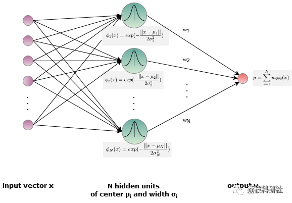
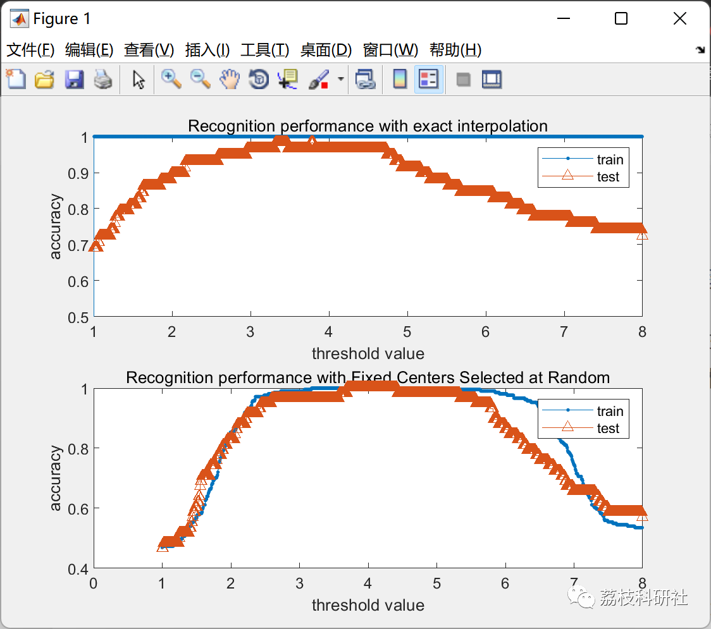
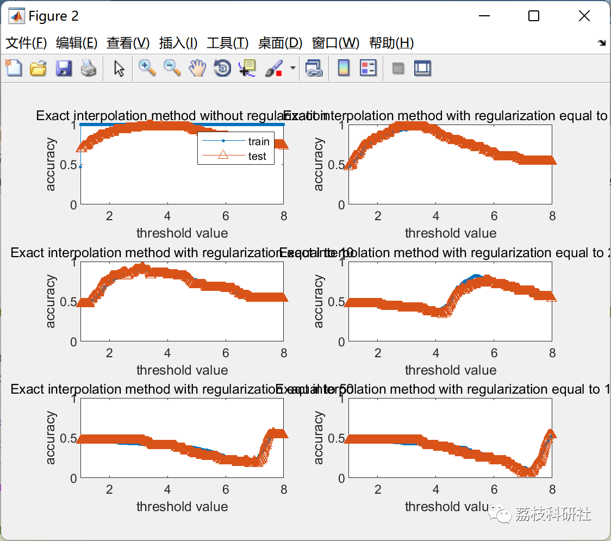
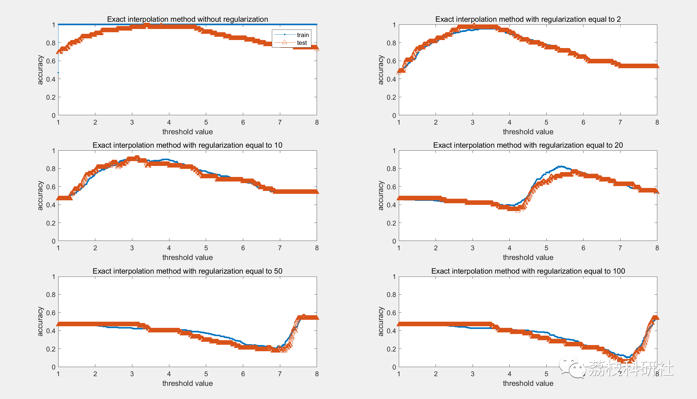
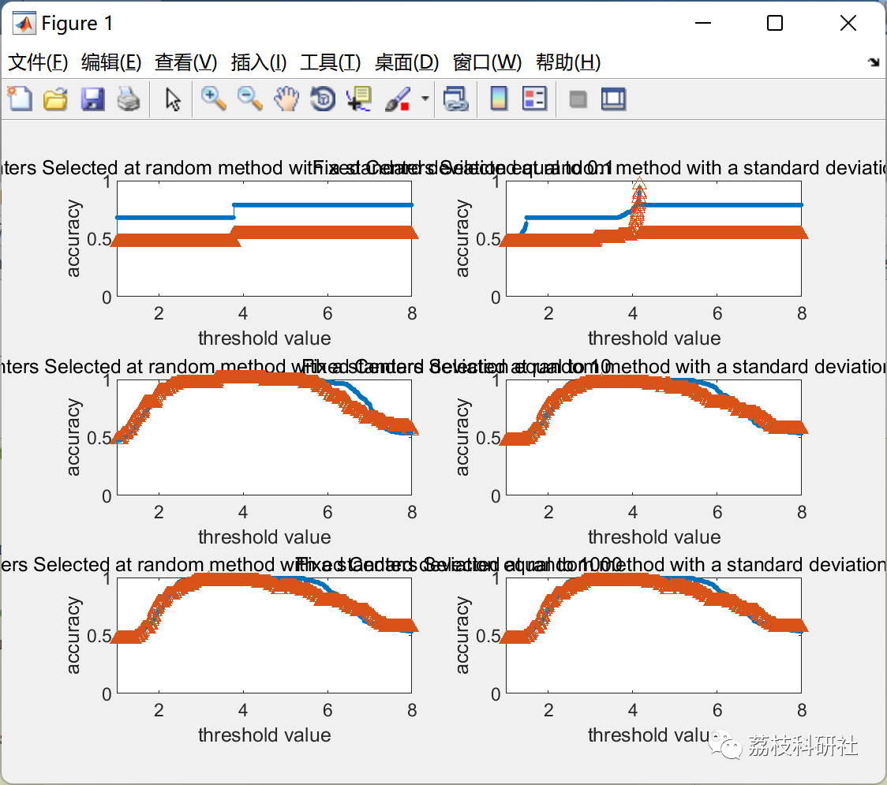
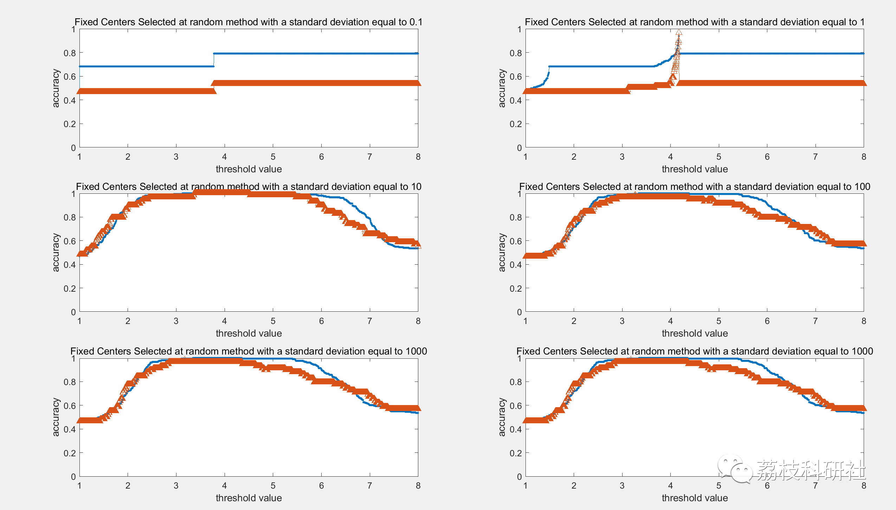

# Handwritten Digit Classification Based on Radial Basis Function (RBF) Networks (Matlab Code Implementation)

💥💥💥💞💞💞💞 Welcome to this blog❤️❤️❤️💥💥💥
🏆 Bloggers' Advantage: 🌞🌞🌞 The content of the blog strives to be rigorous in thought and clear in logic, for the convenience of readers.
⛳️ Mantra: The journey of a hundred miles is half done in the last ninety.
Litchi Research Society
Code Collection: Power System, Intelligent Algorithms and Applications, Neural Network Prediction, Path Planning, Optimized Scheduling, Workshop Scheduling, Image Processing, Signal Processing...
🎁Column Directory Link:
🌈🌈🌈🌟🌟🌟Electrical Code Intelligent Algorithm and Its Application Path Planning Neural Network Predictive Optimization Scheduling Image Processing Workshop Scheduling Signal Processing Romantic Her My Philosophical Thoughts Math Modeling Complete Code Matters
💥1 Overview
The goal of this article is to use a Radial Basis Function (RBF) network to classify handwritten digits from the MNIST dataset (0 to 9). A RBF network is an artificial neural network that uses a radial basis function (RBF) as the activation function. It consists of three layers.
·Input layer
· Hidden layer with RBF activation function.
The output of the network is a linear combination of the input and the radial basis function parameters of the neurons.
The following diagram illustrates this structure:
Each hidden unit is defined by a center and an expansion/width. Each center is a sample drawn from the training set. The activation of the hidden units is determined by the distance between the input vector x and the center of the hidden unit. The closer they are, the higher the activation of the hidden unit. It interprets the behavior of radial basis functions as an activation function.
The learning process includes two stages:
1. Parameterized hidden units: Define their centers and widths. It can be completed by random selection or clustering. These centers are directly taken from the training dataset. 2. Find the weights between hidden units and output units through computing interpolation matrices.
📚2 Running Results
RBFN is only used for classifying handwritten digits 1 and 8 (by extracting label samples other than 1 and 8 to classify the MNIST dataset). For each sample, the network provides an actual output and uses a threshold to classify as label 1 or prediction as label 8.
8. The error rate/accuracy of predictions is dependent on the threshold.  
Two types of hidden units (the first phase of the learning process) have been tested:  
Precise interpolation: We define as many hidden units as there are training samples, with each hidden unit's center being a training sample. "Randomly select fixed centers" method: Randomly select M training samples to define the center of the hidden units.  
The results are as follows:  
2.2 rbfn_regularization  
2.3 rbfn_tuning_std  
We can notice that regardless of the threshold used for the precise interpolation method, the recognition performance on the training set remains at 1. In fact, there is an exact fit between the output of the RBFN and the labels of the training samples. Regarding the "randomly selected fixed centers" method, the accuracy of the training set is not as perfect as that of the precise interpolation training set. In fact, due to the smaller number of hidden units, there is no exact fit anymore. It brings better results for the test set.  
In short, RBFN may facilitate fitting given datasets (high precision on the training set), but it may overfit! It is necessary to choose the correct number of hidden units (not too high) and use regularization.  
🌈3 Matlab Code Implementation  
Click the article's lower left corner to read more.

## Images

<!-- PAYMENT_BLOCK -->

## Get this dataset

- Payment link (Stripe): [Buy now](https://buy.stripe.com/3cs8yP7sY87d0vu9AB)
- Payment QR code: 

<!-- /PAYMENT_BLOCK -->
